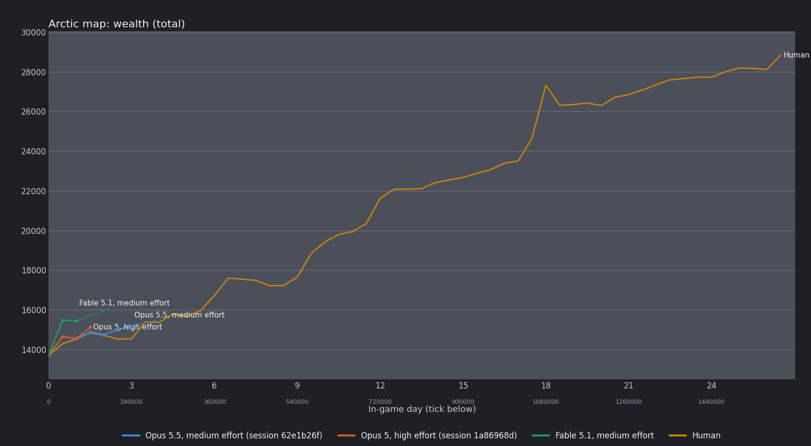
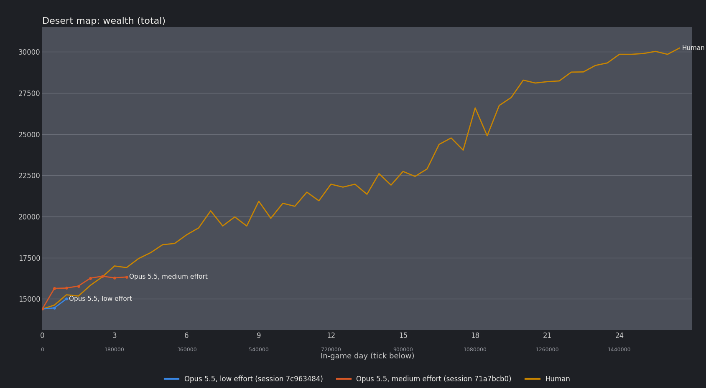

# Wealth history, every recorded point

Wealth curve redrawn from game's savefile (.rws), where each 30k tick represents 12hr worth of in-game hour. Unless said otherwise, the agents were playing in 1x speed. The human played at varying speed (1x~3x).
Agents generally were not able to keep up with game's dynamics at faster gamespeed, hence the cap to 1x speed.
Human runs are clipped at tick 1606873 (where the Desert human run's save ends).

## Arctic

### Opus 5.5, medium effort (session 62e1b26f)

Save: "Opus 5(.5) arctic 1.rws", save tick 201247, 7 points in the save.

| Point | Tick | Total | Items | Buildings | Creatures |
|---|---|---|---|---|---|
| 0 | 0 | 13711 | 9187 | 1529 | 2995 |
| 1 | 30000 | 14633 | 8642 | 2240 | 3750 |
| 2 | 60000 | 14565 | 8489 | 2551 | 3525 |
| 3 | 90000 | 14874 | 8247 | 2742 | 3885 |
| 4 | 120000 | 14748 | 8050 | 2812 | 3885 |
| 5 | 150000 | 14998 | 7532 | 3561 | 3905 |
| 6 | 180000 | 15184 | 7668 | 3561 | 3955 |

### Opus 5, high effort (session 1a86968d)

Save: "Opus 5 Arctic.rws", save tick 115040, 4 points in the save.

| Point | Tick | Total | Items | Buildings | Creatures |
|---|---|---|---|---|---|
| 0 | 0 | 13711 | 9187 | 1529 | 2995 |
| 1 | 30000 | 14639 | 8688 | 2065 | 3885 |
| 2 | 60000 | 14552 | 8425 | 2242 | 3885 |
| 3 | 90000 | 15113 | 7877 | 2722 | 4515 |

### Fable 5.1, medium effort

Save: "Fable 5.1 Arctic 1.rws", save tick 75020, 3 points in the save.

| Point | Tick | Total | Items | Buildings | Creatures |
|---|---|---|---|---|---|
| 0 | 0 | 13711 | 9187 | 1529 | 2995 |
| 1 | 30000 | 15467 | 9977 | 1605 | 3885 |
| 2 | 60000 | 15446 | 9620 | 1941 | 3885 |

## Desert

### Opus 5.5, low effort (session 7c963484)

Save: "Opus 5.5 Desert 1 (low effort).rws", save tick 72544, 3 points in the save.

| Point | Tick | Total | Items | Buildings | Creatures |
|---|---|---|---|---|---|
| 0 | 0 | 14385 | 9394 | 2296 | 2695 |
| 1 | 30000 | 14448 | 9340 | 2328 | 2780 |
| 2 | 60000 | 14994 | 9178 | 2421 | 3395 |

### Opus 5.5, medium effort (session 71a7bcb0)

Save: "Opus 5.5 desert 2 (medium effort).rws", save tick 225016, 8 points in the save.

| Point | Tick | Total | Items | Buildings | Creatures |
|---|---|---|---|---|---|
| 0 | 0 | 14385 | 9394 | 2296 | 2695 |
| 1 | 30000 | 15635 | 9087 | 3152 | 3395 |
| 2 | 60000 | 15652 | 8952 | 3306 | 3395 |
| 3 | 90000 | 15777 | 8835 | 3546 | 3395 |
| 4 | 120000 | 16258 | 9526 | 3546 | 3185 |
| 5 | 150000 | 16373 | 9414 | 3584 | 3375 |
| 6 | 180000 | 16271 | 9339 | 3682 | 3250 |
| 7 | 210000 | 16326 | 9248 | 3783 | 3295 |
