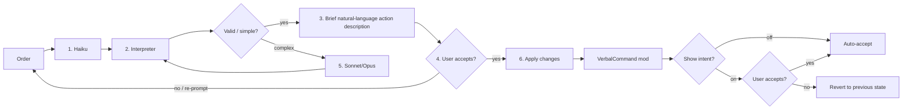

# RimworldVerbalCommands
### LLM-Assisted rimworld mod where users speak to an agent to set groups for different colony functions (e.g. pawn group by weapon they're holding, work priority based on skills, allowed zone based on pawn) and more.

Currently being tested with Anthropic models (claude-haiku-4-5, claude-sonnet-5, claude-opus-5, claude-opus-5-5). 

## Router (V2)


1. **Haiku** looks at the user prompt, then replaces the player's words with something that interpreter can accept.
2. **Haiku's output** goes into the interpreter to see if the prompt is actually valid.
3. Interpreter's actions are described in natural language (without using an LLM) and shown to user in brief. It is likely to be somewhat vague.
4. User can then accept actions as-is, or re-prompt. Complex orders (e.g. setting storage with filters, placing buildings, and combintions of simple tasks) gets routed to sonnet/opus
5. Sonnet/Opus dictates complex queries into interpreter, and the interpreter makes appropriate change by interacting with VerbalCommand mod. (this might not even be necessary)
6. Changes are then auto accepted if show intent option is off, or users can deny changes. if denied, then the game reverts to previous state.

Result: Significant token saving (if it works well enough, that is) since LLMs don't have to write bill changes by themselves, since the interpreter is the one manipulating game state. 

Since the interpreter accepts natural language (e.g. "build shelves that only accept food item into my freezer room"), that's all models need to type in.

End goal is to have easily typable language that is natural enough so people can simply verbally speak without having to use an LLM at all, and also an interpreter/harness so one day LLMs could play rimworld by reading game states and verbally typing (and receiving game state) from/to interpreter.


Older router did not use haiku for regex routing and went straight from user intent (prompt) to model. this caused too many tokens being used since model has to load tooling/data for everything. This albeit brute-force approach led to token waste and LLMs sometimes (model dependent) did not have enough attention to make all of the changes. Many tables were flipped as of result.


### Changing the router model

If you'd like to tweak around and see which model does initial routing best, you can put your own router model in `router_model.txt`:

```
%USERPROFILE%\AppData\LocalLow\Ludeon Studios\RimWorld by Ludeon Studios\VerbalCommands\router_model.txt
```

### Main model and fallback model

Mod settings have two model fields. **Main model** is the router above (it reads every order first and turns it into short sentences; the field edits `router_model.txt`). **Fallback model** is used:

- when the main model's call fails (error, timeout, refusal, cut-off or empty answer): the same prompt goes once to the fallback model, and the order window says so;
- when the order window's "If the main model can't do it, try the fallback model" box is ticked and an order comes back as "cannot" or "not done": the order goes through the router once more with the fallback model in place of the main model. Orders sent as raw sentences call no model, so they are never sent again;
- for the whole order when the sentence router is turned off (the older path).

If both fields name the same model, the fallback is not asked.

### Other providers (.env)

Each of the two models can use its own provider, key and server, set in (next to `router_model.txt`):

```
%USERPROFILE%\AppData\LocalLow\Ludeon Studios\RimWorld by Ludeon Studios\VerbalCommands\.env
```

The mod makes this file on the first order with every line commented out, so nothing changes until a line is uncommented. Keys: `MAIN_PROVIDER`, `MAIN_MODEL`, `MAIN_API_KEY`, `MAIN_BASE_URL`, and the same with `FALLBACK_`. Providers: `anthropic`, `openai` (any server that speaks the OpenAI chat completions format), `claude_cli`, or the presets `ollama`, `lmstudio`, `openrouter`, `gemini`. A key left empty falls back to mod settings; the Anthropic key in mod settings is never sent to another provider. A line in `.env` wins over the matching field in mod settings.

## Mod settings

The settings page only names each setting. What they do:

- **Use Claude Code CLI instead of an API key**: no key needed; uses your Claude Code login.
- **Path to claude.exe**: blank = auto-detect (PATH, then `%USERPROFILE%\.local\bin\claude.exe`).
- **Main model / Fallback model**: see "Main model and fallback model" above. A line in `.env` wins over these fields.
- **Fallback model**: used when main model's call fails. [cannot] gate bypasses are found on verbal command chatbox ingame.
- **Effort**: low/medium/high/xhigh/max. Not sent to non-Anthropic providers.
- **Use the sentence router**: orders become short sentences the mod checks and carries out. On: your order is turned into short sentences by a small model, the mod checks each one and shows you what it will do. If the order is unclear, it asks you a question first and changes nothing. Off: the older way, where the main model plans the whole order.
- **Save router log**: what was sent to Haiku, replies, and what was done.
- **Agent inbox: run orders from text files in the inbox folder**: off by default. When on, each .txt file put in `%USERPROFILE%\AppData\LocalLow\Ludeon Studios\RimWorld by Ludeon Studios\VerbalCommands\inbox` is run as an order (oldest first) and its result is written to the outbox folder next to it. Only that folder is read; nothing listens on the network. The router log is always written while this is on.
- **Record human gameplay (log-based) for training**: off by default. When on, every change you make in the game (designations, blueprints, zones, bills, areas, work priorities, drafting, ordered jobs, pawn settings, forbidding, research) is written as one line with the game time to `REFERENCE_HUMAN_PLAY-<save name>.md` in your Saves folder, same kinds grouped per check. "Save as" copies the record to the new name. Nothing is sent anywhere; the file is for a Claude session to ask you afterwards why you did what you did and write a diary the agents can read.
- **Save sent orders to transcripts.jsonl**: for checking voice accuracy.
- **Collect voice debug data**: Turn this on if you're having transcription issues. Saves debug data you can attach to a bug report.

## Token meter

Turns on whenever agent inbox is on.

## Tip injection

Turns on whenever agent inbox is on. When an order or event matches a tip, its result also gets a short tip from the files in `Tips\`. `I need tips on NAME.` (or `for NAME`) gives the whole file.

You can find the injection settings for each tip inside files of `Tips\summary\`.

## Letting a Claude Code agent play (the `Skill\` folder)

`Skill\` ships what an agent needs to play the colony through the agent inbox:

- `Skill
imworld-play\`: a Claude Code skill. `send.ps1` writes one order to the inbox and prints the outbox result; `play.ps1` does a whole step; `watch.ps1` turns new game events in `inbox_state.json` into chat notifications (armed with the Monitor tool); `launch_game.ps1` starts the game on a save; `launch_play.ps1` starts Claude Code with only the tools play needs; `resume_hook.ps1` prints the newest day note back after a compaction.
- `Skill\PLAYBOOK.md`: how the inbox, time, places and sentences work. `Skill\DIFFICULTY.md`: what Randy Random / Losing is Fun means in numbers.
- `Skill
eference_play\`: a 54-day human play of the same start, read day by day, which every playing agent reads first.

Install: copy `Skill
imworld-play` to `%USERPROFILE%\.claude\skills
imworld-play` (`Skill\README.md` has the steps and the optional hook line for `settings.json`). Then tick "Agent inbox" in the mod settings, load a colony, and ask Claude Code to play RimWorld. The agent's day notes go to `play_log\` inside its skill folder. Nothing in `Skill\` touches the game's `Config` or saves.

The skill can split colony tasks across subagents (schedule, work priorities, drafting, equipment, bills, storage). The per-agent brief is in `Skill\delegates\`. This does, however, mean that in Claude Code the environment needs to have the `Agent`, `SendMessage` and `TaskStop` tools enabled (`launch_play.ps1` does); another harness needs its own equivalents.


Test condition: 1 colony worth of 11 pawns (275x275 map), 1 colony (2 map) of 33 pawns (300x300) and 11 pawns (SOS2 space map, no odyssey), 1 colony of 325x325 map (57 pawns, 33 pawns).

## Current testing done: 
Whatever poor opus 5.5 high needs to do not die on an arctic map. Some of that includes:
Stockpile priority/settings, deterioration checks (mostly software, fires reminder. the model will try to build indoor stockpile as soon as it can), anti-hypothermia measures (subagents will force-draft and drag pawns indoors, and then un-draft when they're safe), turbine blocker logic (fires if placed turbine blueprint has tall block infront of exclusion zone, or a geothermal vent that can be used), sleeping spot/bed handling (including creating spots, configuring it, and putting end tables).

production logic (reminder fires if combined total of prod table is less than total # pawns assigned to that work type, again, software-baased), scheduler/work priority (mostly .md and LLM subagents handling it). prisoner handling (including harvests - yes, I've seen opus5.5 do it), handling research. Currently it's biased to speedrun towards battery, hydroponics/solar > geothermal, though ive seen orchestrators research stuff like smithing as well. 

Hydroponic basin placement (and reminder/tips showing how placement gets done), wall layout/optimization (it used to double-wall between rooms which drove me insane). It will try to put vents/heaters if it's safe to do so. if it would result in dangerous temperature, it won't do it (this is mostly software at core and reminder-based as output). Zone creation/edits, trading (triggers reminder if a trader walks into home area), pathfinder optimization reminder (tick based diff event, fires/records whenever pawn is moving from A/B, compares distance if a door is placed in diff direction of that room).

Longest survived colony is ~12 days on an arctic map with stable growth. 


## Tests needing to be done:
Tldr: the mid-lategame long horizon stuff that even many people don't understand/play well, mostly because colonies havent been able to progress that far.

Run the colony to death to n+ days and make more reminders/tips that a top percentile human player would do. Expect midgame/lategame stuff (namely, making caravan, multitasking across 2 maps, trading on caravan) to be janky/nonexistent. Expect questionable moves making killboxes/killzones. It Barely makes tolerable rooms for indoors right now. Killbox would likely have to use pathfinder logic, probably not something id let LLM to to create blueprint unless it's off of a reference.


## If you're a researcher/engineer trying to get idea from the mod:
Consider looking into verbalizer/interpreter if you want MCP replacement. Expect long development time because the verbalizer here (and id expect yours too, unless theres already some logging function for most macro-able task) fires based on specific action. they are *not* meant to be drop-replaceable to other softwares.

If you are AI/Harness engineer/researcher: consider looking at workflow between verbalizer > DLL > Reminder/tip injects. The reminder/tip *only* fires whenever the LLM sends a router command and is about to do something (or has already done) suboptimal. Tips usually fire between x amount of token for an event/action, reminders fire based on specific events, regardless of in-between. They're essentially guardrails, because most reminders require confirmation from an agent. 

A good example is turbine-reminder, which *only* fires if turbine exclusion zone (basically, the area where turbine takes air in/out) and sees tall blocks in that area, *OR* a steam geyser when it places blueprint. previous agents without this reminder loved to double-stack turbines and needed user input. Alternatively, you can look at vent/heater logic which only fires reminder when it's safe to place HVAC tiles across a room.


Users are welcome to fork mod as needed and test with different models/add feature as necessary.
